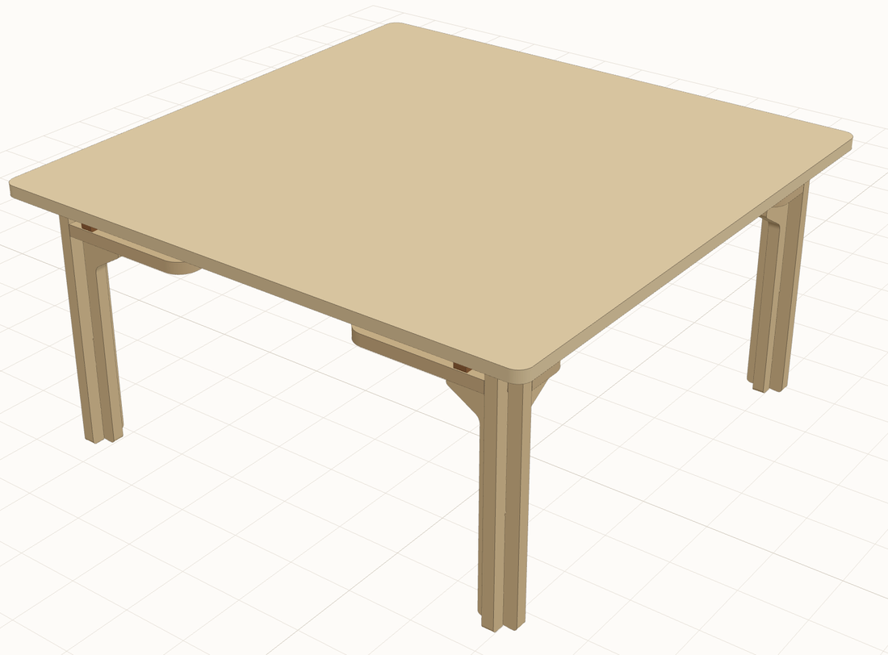
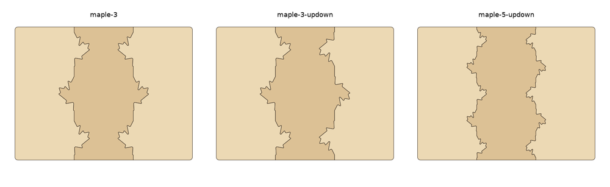
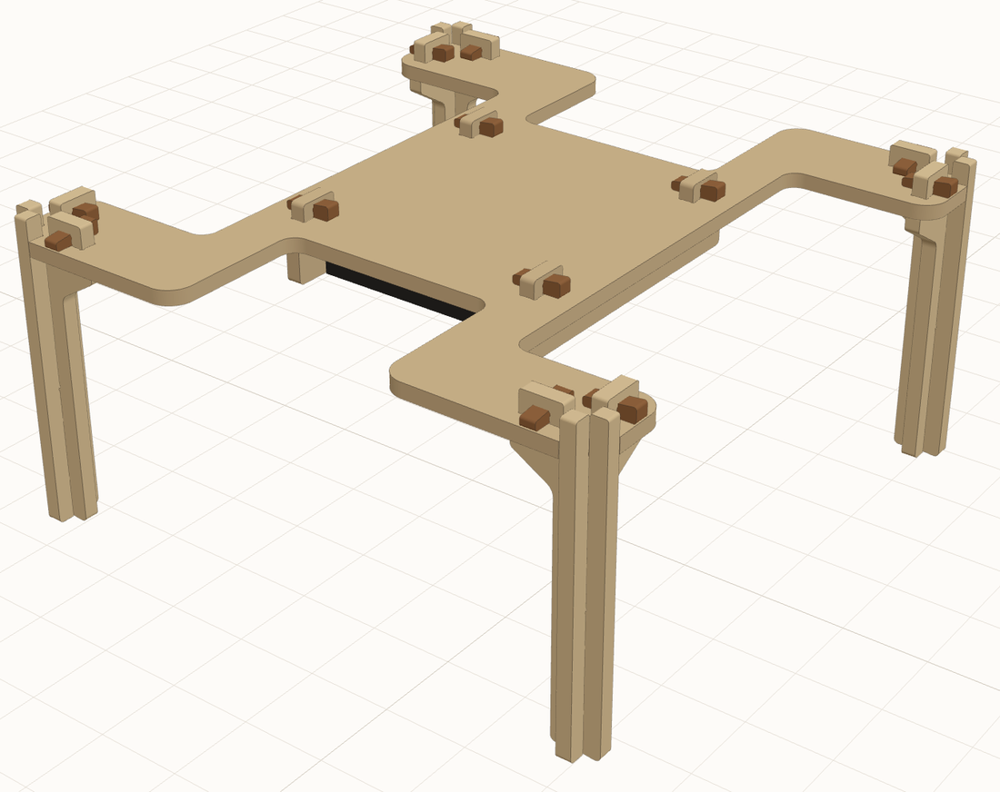
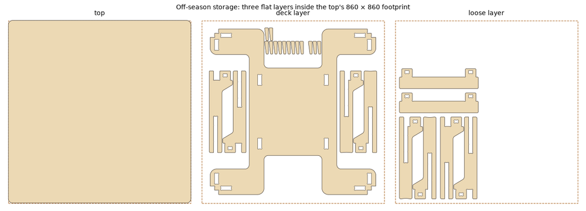

# A kotatsu with no glue and no screws

<!-- story -->


I designed a kotatsu, the low Japanese table with a heater underneath and a quilt draped over it. A CNC
shop cuts every part from birch plywood. It all ships to my door in **one box, for free**, and it goes
together with **no glue and no screws**: wooden wedges, tapped in with a mallet, hold it tight. The 26 parts cost me **CAD $396 with
tax**. The only metal in it is the heater.

Three things got me there:

1. **I set strict rules up front**, so every idea had to pass them.
2. **I let real limits shrink the design**: the shipping box, the futon I could find, and the price.
3. **I checked everything in code before spending a cent**: strength, wobble, knee room and price.

## The rules

I wanted a kotatsu for the winter. I also wanted to make it myself, and I don't own a workshop. So I made
three rules:

- **Plywood only.** Every joint is wood locking into wood. No glue, nails, screws or brackets. The heater
  and its own screws are the one exception.
- **Order it like a book.** Upload a file, pay, wait for the box. No phone calls, no back-and-forth emails.
  I used [uMake](https://umake.ca), a Canadian shop with an instant online quote.
- **It has to be comfortable.** I sit cross-legged, and my knees need about 76 × 32 cm of clear space
  under the edge.

## How the limits shaped it

My first idea was a big 120 × 80 cm table. A top that big doesn't fit in a normal parcel, so I split it
into three boards and went down a lovely rabbit hole of decorative seams to hold them together: dovetails,
Japanese arrowheads, salmon tails, fir-cone scales and half maple leaves. I even drafted a request to
commission a local Secwépemc artist, rather than borrow Indigenous designs.



Then I measured my room again. For a while there were two tables, then one round one. Round kotatsu
futons turned out to be rare and expensive to ship here, so the table became square.

The shipping box decided the size. A 90 cm top cost **$200 extra** to ship. One that fits in a 91 cm box
ships free. So the top is **86 × 86 cm, in one piece**, and the seams went into a git tag for another
day.

The frame changed too. It started with solid side panels. Those hit my knees, so it became a *yagura*:
four "+"-shaped corner legs holding up a flat deck, with the heater hanging under the deck. I sketched
slimmer legs twice, and each sketch came out lighter and cheaper than what I had.



## Checking it in code

Every dimension lives in one file, `params.toml`. Python turns it into the shapes the shop cuts, and a
set of tests checks each version:

- **Can a router cut it?** A spinning bit can't make sharp inside corners, so every slot gets small round
  "dogbone" corners.
- **Will it fit together?** Plywood sold as 18 mm can be anywhere from 17 to 18.9 mm thick. The slots
  have small bumps you sand to fit, and the wedges take up the rest.
- **Will it wobble, tip or break?** A little model of each joint gives the sway: under a millimetre for a
  firm push. A plate model of the top says napping on it with a 7 kg cat and a laptop uses about 7 % of
  the wood's strength.
- **What will it cost?** I uploaded test shapes to work out how uMake prices. About three-quarters of
  the cost is cutting time, not wood. So I traded the deck's cut-out windows for notches from the edge
  (the H shape above), which saved about $20.

The parts even pack flat into the top's footprint for summer.



## Where it stands

I placed the order in October 2026. One surprise: uMake's checkout ends with "a representative will reach
out to confirm". So I still get one email. I haven't assembled it yet, and the first fit-up will
surely teach me something. I'll add photos when the box arrives.

I worked through all of this over about two days with an AI coding agent. I made the choices and drew
the sketches. It wrote the geometry code and tests, ran the numbers and filled in the quote forms.
<!-- /story -->

## Make your own

The website has the drawings, a 3-D view, the cut sheets and all the numbers:
**https://lixo.org/kotatsu/**. The cut files (DXF, in millimetres) are at
**https://lixo.org/kotatsu/dxf/**.

| | |
|---|---|
| Top | 860 × 860 × 18 mm, one piece, sits loose on the frame with the futon in between |
| Frame | four "+" legs (8 plates, 2 shapes) under an H-shaped deck; 2 cheeks hold the heater |
| Joints | cross-laps and wedged through-tenons; 14 wedges (2 spare) |
| Height | about 40–41 cm with a futon |
| Order | 26 parts, 16.6 kg, one 91 × 91 × 16 cm box; CAD $353 + tax on uMake (Oct 2026) |
| Heater | 120 V 400 W replacement kotatsu heater, 29 × 29 × 5 cm, screws in at the sides |

```sh
uv sync
make test      # the checks
make dxf       # out/dxf/parts/*.dxf, sheet layouts and out/BOM.md
make site      # the website, in out/site
make dev       # serve it on :8765 and rebuild on every change
```

`PLAN.md` has the decisions and open questions. `docs/` has the research on the shop, heater, futon
and quote. `AGENTS.md` has the project's rules.

**Caveats.** The plywood strength figures are rough textbook values, so read the load numbers as "lots of
margin", not as a certificate. uMake sells this sheet as "19mm", and the joints are designed for
17.0–18.9 mm. Follow your heater's instructions and clearances, and make sure it's rated for your mains
supply. The earlier designs are kept as git tags: `seams-archive` (split tops with decorative seams) and
`frame-variants-archive` (solid-sided and splayed-leg frames).

## License

MIT, see `LICENSE`.
