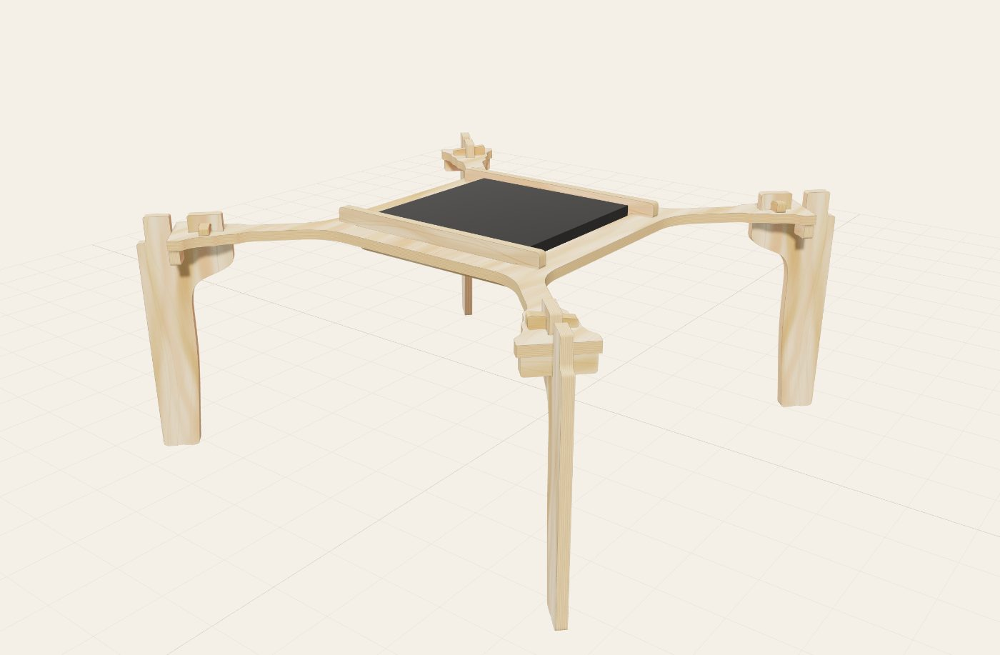
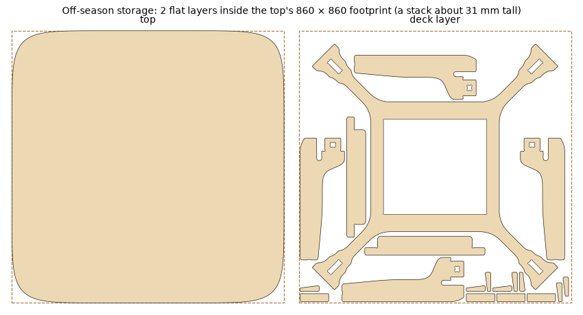

# A kotatsu with no glue and no screws

<!-- story -->
<!-- page: overview Home -->
[](docs/img/home.jpg)

I designed a kotatsu, the low Japanese table with a heater underneath and a quilt draped over it. A CNC
shop cuts every part from birch plywood and ships it all to my door in one box, for free, and it goes
together with **no glue and no screws**. Wooden wedges, tapped in with a mallet, hold it tight. The 26 parts came to
CAD $396 with tax in uMake's cart, and $455 once uMake had finalized the order. The only metal in it is the
heater.

Three things got me there:

1. I set strict rules up front, so every idea had to pass them.
2. I let real limits shrink the design: the shipping box, the futon I could find, and the price.
3. I checked everything in code before spending a cent: strength, wobble, knee room and price.

## The rules

I wanted a kotatsu for the winter. I also wanted to make it myself, and I don't own a workshop. So I made
three rules:

- **Plywood only.** Every joint is wood locking into wood. No glue, nails, screws or brackets. The heater
  and its own screws are the one exception.
- **Order it like a book.** Upload a file, pay, wait for the box. No phone calls, no back-and-forth emails.
  I used [uMake](https://umake.ca), a Canadian shop with an instant online quote.
- **It has to be comfortable.** I sit cross-legged, and my knees need about 76 × 32 cm of clear space
  under the edge.

<!-- page: design Design -->

## How the limits shaped it

This chapter is v1, the table I built and use every evening. Version 2 has its own chapter.

I made most of this table's choices around things I couldn't change: a cardboard box, my knees, a bathroom
scale and uMake's price list. Here are the four fights, and how each one ended.

This is the very first full design, from the first afternoon. It had a 120 × 80 cm top in three boards joined
by dovetails, sitting on solid side panels.


And this is where it ended up:


### A top that fits in the box

I wanted a big table, 120 × 80 cm. uMake ships free in one box up to 91 cm, so a top that size had to
come in three boards, and joining boards without glue is where the fun was: dovetails, Japanese
arrowheads, salmon tails, fir-cone scales, half maple leaves. I'd drafted a request to commission a
local Secwépemc artist to design one.


Then I measured my room again, and it works much better with a square table. A round top looked lovely,
but it cost $200 more to ship, and round futons (the quilt that drapes over a kotatsu) were hard to find at a
fair price. I gave in to the box and made the top 86 × 86 cm,
in one piece, with no joinery at all. I cancelled the commission and put the seams away in a git tag.


### Room for my knees

Sitting cross-legged, my knees need a space 30" wide and 12.5" high. The first frame had solid side
panels that slot together at the corners. It was strong and simple, and the strip of wood along each
side (the apron) sat exactly where my knees wanted to be. I tapered the legs and flared the feet for a
little more room, then dropped the aprons altogether, which gave the knees all of it. That's a *yagura*. Four "+"-shaped corner
legs hold up a flat deck, the heater hangs under the deck, and the middle of each side is open, with
34 cm of clearance under the deck.


### Under the weight limit

The first yagura legs were plain strips, and the weight crept up. Free shipping stops at about 20 kg, and
the order came to 20.4 kg, so the cart charged $195 to ship it. I cut windows in the legs and the deck to get it
back under. Then I sketched my own leg shape, twice. It's full width under the deck, where the joints are, then a
sloped shoulder (a *haunch*) takes it down to a 60 mm leg, light enough to need no windows.


### Notches instead of windows

When I cut holes in the deck, the table got more expensive. From a few test uploads I thought I saw why. Most
of uMake's price was the router's path, not the wood, and a window is nothing but cutting. So I opened each
window out to the edge, which took the same wood away with a metre less cutting, and about $20 off. Last, I
rounded the new corners (the *fillets*). The notches were the right call, but for a reason I only found in
Version 2.


Here's the frame all together, without its top:


## Checking it in code

I couldn't afford to learn things by cutting wood. Every mistake would be a new order and another week
of waiting. So I keep the design in code, and every time I change something I run over a hundred tests that
try to break it. The tools are the same for both versions; the numbers in this chapter are v1's unless I say so.

Every dimension lives in one file, `params.toml`, including the things I'm not sure of yet:

```toml
[material]
t_nominal = 15.0      # v2: 15 mm throughout (v1 was 18 mm, uMake's "19mm")
t_min = 14.1          # mill tolerance about -0.9, TODO-verify
t_max = 15.7          # mill tolerance about +0.7, TODO-verify

[cnc]
bit_d = 6.35          # 1/4" router bit -> dogbone radius bit_d/2
part_gap = 5.0        # min spacing between parts (uMake)
sheet_margin = 20.0   # margin around sheet (uMake)
```

From it, I generate the outlines the shop cuts in Python (with `shapely` for the 2-D shapes and `numpy` for
the maths), and I wrote the tests to ask the same questions a woodworker would. The snippets below are from the repo,
lightly trimmed.

### Corners a router can cut

A router bit is round, so it can't cut a sharp inside corner. It leaves a little curve the size of the
bit, and a square edge won't seat in a slot like that. The fix is a *dogbone*, a small circle cut just
past each inside corner. To check that every corner has one, I borrowed a trick from image processing
called *closing*. Grow the shape by the bit's radius, then shrink it back. Anything the bit can't reach
gets filled in, so if the result isn't the same as the drawing, some corner is too sharp:

```python
def closing(g: BaseGeometry, r: float) -> BaseGeometry:
    return g.buffer(r, quad_segs=Q, join_style="round").buffer(-r, quad_segs=Q, join_style="round")


def router_cuttable(g: BaseGeometry, r: float, tol: float = 0.5) -> bool:
    """True if every concave corner already has radius >= r (closing adds no real material)."""
    d = closing(g, r).symmetric_difference(g)
    return all(piece.area < tol for piece in getattr(d, "geoms", [d]))
```

I run every frame part through it. A square corner leaves about 2.2 mm² behind, which is easy to tell
apart from rounding noise.

### Joints for any thickness

This was the scary one. v1's plywood, sold as 18 mm, could be anywhere from 17.0 to 18.9 mm thick, and I
wouldn't know which until the box arrived. So I cut every slot for the thickest sheet (19.2 mm), with two
small bumps on each wall (*crush ribs*) that narrow it to 18.2 mm. If a sheet turned out
thicker, I'd sand the bumps down. The wedges have a 1:8 taper, so they take up whatever is left.

I gave v2's 15 mm sheet the same treatment, for anything from 14.1 to 15.7 mm, with one change. Its bumps stand
taller and leave exactly the thinnest sheet between them, so the fit is snug on any stock, with up to 0.8 mm a
side to sand at the fit-up.

I run each joint test three times: at the thinnest, the nominal and the thickest sheet. Here's the one
for the leg wedges. Whatever the deck's real thickness, the gap above it has to land somewhere along
the wedge, thicker than its tip and thinner than its head, and the wedge must stay below the futon:

```python
T_RANGE = (BASE.material.t_min, BASE.material.t_nominal, BASE.material.t_max)


@pytest.mark.parametrize("t_deck", T_RANGE)
def test_leg_wedges_clamp_the_deck(Y, t_deck):
    P, L, parts = Y
    z0, z1 = yagura.leg_hole_z(P)
    top = L.z_deck_bot + t_deck
    wl, wh = yagura.wedge_dims(P)
    need = z1 - top
    assert wh - wl * P.fit.wedge_taper < need < wh
    assert L.z_deck_top + wh <= L.H - 3, "wedges stay under the futon plane"
```

### Will it wobble?

For v1 there was no big engineering package, just small models I could read. I modelled each leg-to-deck joint as a
handful of springs: the leg's shoulder pressing up under the deck, the wedge pulling up the *tenon* (the
tongue on top of the leg that pokes up through a hole in the deck, the *mortise*), and the tenon's faces
bearing on the sides of its hole. The catch is that wood in contact can push but
not pull. Lean on the table, and one side of a joint can lift off. I handled that with
"compression-only" springs, smoothed just enough (a *softplus*) that Newton's method can step across
the moment a gap opens:

```python
EPS = 0.002   # mm: contact smoothing (softplus) so Newton can cross contact changes


def _pos(c):
    return EPS * np.logaddexp(0.0, c / EPS)
```

In the model, a firm 100 N sideways push (about 10 kg) swayed v1 about 0.9 mm (v2: 1.6 mm). With it I also
caught a sneaky problem before I ordered. The first legs had wood on only one side of each joint, and tapping the
wedge in would have twisted each leg about 9 mm at the foot. I added a 10 mm shoulder on the other side, and that fixed it.

### How strong the top is

The top is a loose board resting on the tops of the legs. I modelled it as a grid of little
beams that bend and twist like a plate. The legs can hold the top up but can't hold it down, so I solve it
in rounds: solve, find any leg that would have to pull, let it go, and solve again.

```python
for _ in range(30):                                       # compression-only supports
    fixed = sorted(idx(i, j) for i, j in active)
    free = np.setdiff1d(np.arange(N), fixed)
    u = np.zeros(N)
    u[free] = np.linalg.solve(K[np.ix_(free, free)], F[free])
    R = F - K @ u                                         # what the pads must push on the top (+ = upward, compression)
    neg = [(i, j) for i, j in active if R[idx(i, j)] < -1e-6]   # pad would have to pull the top down
    if not neg:
        break
    active -= set(neg)
```

Before trusting it, I checked it against the textbook answer for a square plate with a weight in the
middle (Timoshenko's), and it came within 3 %. A test repeats that check on every run. Then come the loads I actually care about:

```python
"nap: cat curled in the middle, laptop pushed back": arms(nap) + curled_cat(0, 120) + laptop,
"slump: flopping down (x1.5) + cat jumping up mid-table (x4)":
    arms(Ld.slump * nap) + paws(Ld.cat_impact * cat, 0, 0) + laptop,
"cat lands on the corner (x4), nobody else": paws(Ld.cat_impact * cat, h - 60, h - 60),
```

On v1's 18 mm top, napping hunched over the table with a 7 kg cat and a laptop used about 7 % of the
wood's strength and sagged it 1 mm. Even an 80 kg adult sitting hard on an edge used about a quarter. v2's
thinner top works harder: 9 % and 37 %.

### Modelling uMake's price

uMake quotes instantly, so I uploaded a few test shapes and wrote down the prices. Each part costs a
rate per square metre plus a rate per metre the bit travels, and the order total adds a fixed amount per
order on top. I fitted that on all five of my 15 mm quotes, and it matches each within 1.4 %:

```python
A_RATE, L_RATE = 64.17, 5.84     # per m2 of bounding box, per m of cut (raw units)
FIXED, PER_RAW = 166.47, 0.6693  # total = FIXED + PER_RAW * raw  (five 15mm quotes, 2026-11)


def raw(g) -> float:
    return A_RATE * bbox_m2(g) + L_RATE * features(g)[1]
```

That's the model today. In my first version, for v1, each part paid for the wood actually in it, plus a
little per hole. With it I predicted the real order at $353.38 against the $353.33 I paid, and I concluded
that about three-quarters of the price was cutting, which is why I turned the deck's windows into notches
open to the edge. I was right about the total and wrong about the reason. From Version 2's quote I learned
that uMake charges the wood by each part's *bounding box*, the smallest rectangle round it. Cutting is about half the price, and a window never saves
money (see The quote, in Version 2).

### Packing the sheet

All of v1's 26 parts fit on one 48 × 96" sheet, and v2's 18 do too. uMake lays out its own sheets, so
this is for anyone cutting it on their own router, and for summer. To pack them, I draw each part on a grid
of 4 mm squares, then use a Fourier transform to test every position on the sheet at once, the way image software finds a
pattern in a photo:

```python
F = np.fft.rfft2(occ.astype(np.float32), sh)
M = np.fft.rfft2(m[::-1, ::-1].astype(np.float32), sh)
corr = np.fft.irfft2(F * M, sh)[mh - 1:H, mw - 1:W]
return corr < 0.5
```

I place the big parts first, and the wedges fall into the gaps. Then I measure the real distances in a test: no two
parts are closer than 7.35 mm (the shop asks for 5, and the bit needs room to pass between them), and
nothing crosses the 20 mm margin.

With the same packer I fold the parts flat into the top's footprint for summer.


<!-- page: build Build -->

## Building it

The box arrived at the end of October: one flat parcel, with every part in a single shrink-wrapped stack.
The feline QA department was eager to begin inspections.

[](docs/img/build-1-box.jpg)

Unwrapped, it's the H-shaped deck, the two heater cheeks (the boards the heater screws between), eight
leg plates crossed into four "+" legs, and a small pile of wedges. The top leans at the side.

[](docs/img/build-2-parts.jpg)

I stood the legs up, dropped the deck over their eight tenons, and hung the cheeks through it. A wedge goes
through every tenon and cheek tab. For now I pushed the wedges in by hand, not with a mallet, so the table still
comes apart easily.

[](docs/img/build-3-frame.jpg)

With the frame upside down, I screwed the heater in between the two cheeks, after drilling a pilot hole for
each screw.
Right way up again, it hangs under the deck, grille down.

[](docs/img/build-4-heater.jpg)
[](docs/img/build-5-under.jpg)

Putting the frame together took under a minute. The heater's holes took about five more, most of them
spent looking for the right drill bit.

## In use

At first I put a fleece blanket I had at hand over the frame, with the top sitting on it. The futon I ended up
with is an oversized king quilt, 120 × 120 in, folded and tucked in so it doesn't spread so far, and it works
really well. It's tea, crosswords, and the cats
keeping an eye on things. The heater is incredibly warm and comfortable. I cranked it for a couple of hours to get rid of
the factory smell, then lowered it to medium.

[](docs/img/use-crossword.jpg)
[](docs/img/use-tea.jpg)
[](docs/img/use-blanket.jpg)
[](docs/img/use-cats.jpg)

<!-- page: v2 Version 2 -->

## Version 2

v1 works, and I use it every evening. Living with it, I found four things I'd change:

- **A higher heater.** v1's hangs under the deck, right where shins go.
- **A lighter box.** v1's came to 16.6 kg, not far under the 20 kg where free shipping stops.
- **Fewer wedges.** v1 has 14. Let gravity do some of the work.
- **Rounder corners.**

Version 2 is designed, checked and quoted, but not ordered yet. This chapter is how I got there, detours
included. I designed two chairs and dropped them, and I replaced my first set of legs.

### Moving the heater into the deck

I cut a hole in the middle of the deck and turned the two heater cheeks into a cradle. I screw the heater
between them on the floor, then lower the whole thing into the hole. A tab at each end of the cheeks (an
*ear*) rests on the deck, so gravity holds it up, and in summer it lifts straight out. That's four fewer
wedges, and 304 mm of clear height under the heater instead of 286.

I first had it higher, at 323 mm, until I noticed that the heater's control panel (the plug, switch and
knob) sits on one end, where the deck would be. So I lowered it just enough for the panel to clear the deck.
Its screws are near its top, so I made the cheeks 46 mm tall, reaching only a little below them.

With the heater up in the deck, the futon lies just over it, on the cheeks, with about 2 cm of air above the
heater's top, as on a traditional open frame. So I measured it on v1. On high, the top of the heater reaches
about 40 °C, warm to the hand, and I checked the placement against its manual. The grille and the fan face
down, into open air, and the futon must never be tucked into the frame under them. Where the manual's
clearances differ from anything here, I follow the manual.

### Thinner plywood

I dropped every part from 18 to 15 mm, and checked each joint again across the range the shop's 15 mm sheet
might really measure (14.1 to 15.7 mm, TODO-verify). The top bends a little more: when an adult sits hard on
its edge, it sags about 7 mm instead of 4 (8 on the thinnest sheet). From a test quote I learned that 15 mm
costs about the same as 18 mm, so the saving is weight, not money.

### An X deck and a squircle top

I redesigned the deck as an X. Four arms at 45° join a pad at each corner to a ring round the heater,
with a big fillet in every inside corner. For v1 I had rejected an X deck, because its openings let the futon sag
right where the knees go. The ring round the heater holds it up there. On each corner pad I kept only the wood
that has a job: round the mortise, under the wedge, and over the tops of the legs.

The top is a *squircle*, a square whose corners bend gradually out of the straight edges, where a radius starts
bending all at once. I liked it so much that I gave the legs (still the "+" ones then) the same treatment. I
made the haunch one smooth S-curve instead of a slope with two small fillets, and the feet and shoulders
squircles too, as round as their jobs allow. (The feet stand on just 8 mm at each end, so they can't get much
rounder.)

### The first legs, with fewer wedges

v1's legs were two plates crossed into a "+" at each corner, each plate with a tenon and a wedge. I wondered
if gravity could hold them instead. It can't on its own. In the wobble model, the frame would sway about 9 mm under a
light push. But one wedge per leg is enough, if the wedges alternate. Each leg's other plate is trapped
between the floor and the wedged-down deck, and hangs on its partner when I lift the frame. That plate
doesn't even need a tenon, so I cut only 4 mortises in the deck instead of 8. Even when I counted the
gravity-held plates as doing nothing, I got only 2 mm of sway in the spring model under a hard shove (v1:
under 1 mm).

These legs didn't last. When I ran the next check, they turned out weaker than they looked.

### A second opinion

v1's checks are small models I can read. For v2 I wanted a heavier check, so I had a second AI agent write a
*finite-element* model (FEA: each part cut into small triangles that are solved together) of the three parts
that carry load: the top, the deck and the leg plates. It worked on its own branch and reported back:

- For the top, the simple model was right, within 10 %. (Later I ran it on the real squircle instead of a square,
  and it came out 9–15 % on the safe side.)
- The deck works harder than I thought, up to about 68 % of its strength under a hard press on the
  ring round the heater, not 40 %. Arms at 45° to the grain are softer and weaker than I had assumed in the
  simple model. That's fine as long as the wedges stay tight. With slack wedges it was overstressed, so I'll
  re-tap them every season. (The final deck, further on, does better.)
- The legs had a real problem. Above the slot where the two plates cross, the wedged plate is two separate
  22 mm fingers, and the wedge hangs the whole joint's bending on one of them. In my spring model I had quietly
  treated the slot as glued shut. A hard 200 N shove used 160 % of the leg's strength and swayed it 12 mm.

My first fix, a shallow slot in one plate and a deep one in the other, made it worse, because the peak just moved to
the new slot's bottom. The plain fix worked. I widened the narrow part of the legs from 60 to 70 mm. The same
shove then used 87 % at worst and swayed the frame 7.2 mm, for 0.25 kg and 2 cm of room between the legs at shin
height (none at the knees).

### Seeing the stresses

Numbers in a table are easy to skim past, so I had the 3-D view paint them on the parts. Pick a load case
and the part turns blue where it's idle, yellow at half its strength and red at all of it. It bends,
exaggerated, as the load comes on and off.


I learned something about the model from the first version, too. In the "+" legs' case, one plate swung right
through the other. Nothing was wrong with the joint. Each part is analysed on its own, its neighbours standing
in as springs and supports, and I had the view draw one plate bending while the rest of the frame stood still.
At true scale, the slot round the other plate narrows by 0.2 mm at most, and that plate has 0.9 mm to spare.
Now I move the whole frame with the analysed part, so the feet stay put while the deck sways and the other plates lean along.

### Two chairs

There was room on the sheet and in the budget for two *zaisu*, legless floor chairs with a back. Each was
five parts and no wedges. The seat board's tabs went through the side frames, so sitting down held the chair
together, and the stretcher and the back hooked in, then dropped 6 mm to lock. They were squircles all over,
down to cut-outs in the seat and the back shaped like the top.


The back posts worked at only 15 % of their strength, so I asked for less wood. Looking into it, I found
parts nobody was checking. Leaning back pushes the back panel and the seat board face-on, across their 15 mm, and
those worked at about 40–46 %. So I left those as they were, and slimmed the posts from 60 to 50 mm. Then in the
FEA I found a hot spot in the small inside corner behind each back post, where it meets the runner: a hard flop back
used 85 % of the wood's strength there. I gave that corner a bigger curve, and the runner 4 cm more length to
make room for it, which brought it down to 68 % and made the chair harder to tip back. Each chair came to about 3.4 kg.

I also learned from the chairs how I sit. I'd measured my knee height (32 cm cross-legged) on the bare floor, and a
chair raises it by the whole seat. Even with the seat board as low as the shop's rules allow, 31 mm off the
floor, my knees would only fit under the table's edge on a thin, firm cushion (4–5 cm). I hadn't caught
it with the comfort model, because I'd never made it check the top itself, so any knee height "fitted". On a zaisu I'll sit
with my legs out under the table instead, thighs under the deck and feet under the heater, with room to spare
even on my 10 cm cushions. On the floor-pillow sides v2 has about the same knee room as v1, with a little more
height and 2 mm less reach under the top's edge.

### The quote

The whole thing, table and both chairs, quoted at $501.66 for 28 parts, all instant and shipping free in one
91 × 91 × 20 cm box. That was 6 % more than I'd predicted with my price model, and part by part I was further off. The
open X deck and the chairs' side frames were a quarter dearer than predicted, and small solid parts cheaper. I could
see why from the pattern: uMake charges the wood by each part's **bounding box**, the smallest rectangle round
it, not by the wood actually in it. When I fitted the model that way, every line but the tiny wedge matched within 2 %. So
v1's lesson needs a correction. A window never saves money, only weight, because it just adds cutting. (It still had
to happen in v1, where weight was what stood between me and free shipping.)

Then I took the chairs out of the quote. The table alone was $328.53, so the two zaisu were adding $173,
and I'd found an adjustable zaisu online for about $70, delivered. So I put the plywood chairs in the
archive (the `zaisu-archive` tag has them, FEA and all), and I'm buying one. What I learned from them stays.
On a chair I sit with my legs out, and I added a check to the comfort model that a knee can't go higher than
the top.

### Smoothing every curve

Once I knew uMake charges by the bounding box, wood inside a part's outline was free, so I could go after
looks for nothing. I gave the "+" legs a soft taper below the joints, so each leg's inner edge became one long
curve from the shoulder to the foot. It even made them a little stronger, 81 % instead of 87: the lower leg
gives a little, so the joint at the top takes less. I gave the heater cheeks and the wedges' heads
rounder squircle corners, and the top softer ones.

### Diagonal legs

With the design settled I kept poking at it, and asked what the legs could be if they didn't have to be two
crossed plates. The idea I liked best was the simplest: one plate per corner, standing on the diagonal. Half
the leg plates, less cutting, and from every side you'd see a single thin edge. I saw the catch in the
numbers straight away. Twist the frame, and a single plate has nothing to resist with but its own thin edge
on the deck, and the joint rocks open at about 32 N.

I rescued it with a *crosspiece*, a small board that drops into a slot in the plate's head (its full-width top,
under the deck), across the plate. The deck bears on its top edge, so the joint now has a 90 mm base against
twisting, and stays shut up to about 200 N pushed at a corner. That's a best case, since in the model I give each
crosspiece the wedge's whole clamp through the deck, so I'll twist the frame by hand at the fit-up. Then I
shaped the head with the FEA. A tall crosspiece needed a deep slot, and the slot's bottom landed in the haunch, where it
used 183 % of the plate's strength under a hard shove. With a short one (25 mm) and a higher haunch, it came down
to 84–95 %, and with a round-bottomed slot to 75 %, with no dogbones at all, since the crosspiece's square
edges can sit on the curve.

Above the deck, each plate rises as a *post* that the top rests on. On the diagonal, the squircle top's edge
comes closest to the legs, so I ended the posts 14 mm in from the corner. Each leg's outer edge sweeps in to
there in one long curve from the foot, so the post reads as part of the leg.



In a last pass I shaved and smoothed every curve that didn't have a job. The legs taper in one long line, the
crosspieces arch underneath, and the deck's arms flare into the ring and the pads with much bigger fillets.
I made each corner pad one smooth outline, flaring out of its arm like a trumpet, with rounded far corners,
so there's nothing left to fight with sandpaper. The bigger fillets made the deck stronger, too. A hard press on the ring
now uses 60 % of its strength, and with slack wedges it stays under it (97 %, was 127 %).

The rest is handwork: an undercut under the top's edge, so it reads thinner (a 9 mm rim on the 15 mm top), a
small roundover on every edge, and two thin coats of Osmo Polyx-Oil 3043 Clear Satin, the oil I used on v1, on
both faces equally so the top can't cup over the heater.

### A kick

With every line smooth, the legs still looked a bit plain: straight posts with a taper. I asked for a curve,
and I liked it best as a *kick*. Below the joints, the whole lower leg sweeps outwards, both edges together, so
the foot lands 30 mm past the frame's corner. It reads as a splayed Japanese leg. The joints stay where they
were, and in the FEA the legs still use 74 % of their strength under the hard shove, as before. The wider
stance makes the table much harder to tip: pushing down right at an edge, it would take about 4.5 kN, though
the loose top would lift at its far side long before, at about 640 N.

Then I asked whether, with the better stance, the legs could be thinner. Not just like that. At 56 mm the root
of the head slot went to 106 %. A narrower leg makes the haunch steeper, and its bend crowds the slot. I fixed it
with a longer, gentler haunch. Now the legs are 56 mm wide, narrowing to a 46 mm foot, and the shove uses only
63 %, less than before. It costs 17 mm of room between the legs. With the kick and the slimming, uMake's
quote went from $303.98 to $306.84. uMake prices each part by its bounding box, and the plate's got 29 mm wider.

I still have a bag of wedges left over from v1, the same shape as v2's but cut from its thicker sheet. I widened
the wedge holes to take them and dropped the wedges from the order, and the quote fell by only $4.72, because the smaller
order got less of uMake's volume discount on every other part. For that, new wedges that fit snugly are the better
deal, so I put them back.

### Summer

In summer I take the table apart into a flat stack the size of its top, as with v1: two layers, about 3 cm.



### Where v2 stands

Against the "+" legs, the diagonal ones are better nearly everywhere. uMake quoted the table at **$306.91**,
$21 less than the "+" legs' $328.02. The cutting drops from 22.5 to 16.8 m, the table is 1 kg lighter, and
there's a little more room between the legs. In the FEA they're stronger and stiffer too (the table below has
the numbers). The one new job
is at the fit-up: I cut each crosspiece 1.5 mm taller than the nominal slot depth,
so even the thinnest stock reaches the deck after settling into the round seat. I sand its top edge until the
deck sits on it and on the plate's shoulders together. After that, I keep the leg wedges tapped in and check them each
season. With them slack, a hard press on the deck's ring comes close to the wood's rough strength. (The "+"
legs are in the archive, tag `plus-legs-archive`.)

So, against my four wishes: the heater rides 18 mm higher and lifts out, the box is about 5 kg lighter, the
wedges go from 14 to 6, and every corner is rounder.


| | v1 | v2 |
|---|---|---|
| Parts | 26 | 18 |
| Weight | 15.9 kg | 10.4 kg |
| Wedges | 14 | 6 (4 + 2 spares) |
| Clear height under the heater | 286 mm | 304 mm |
| A hard 200 N shove, finite elements | not checked | 63 % of the legs' strength, 6.1 mm of sway |
| uMake | $353.33 in the cart ($405.83 once uMake finalized it) | $306.91 (a quote, not an order; about $344 with tax; the "+" legs quoted $328.02) |

Before I order it, I want to measure how I really sit (no tape to hand yet), and I'd like to know how thick
uMake's "15mm" sheet really is (TODO-verify). A local yard, Windsor Plywood in Vernon, measures its 15 mm
Baltic birch at 15.0 ± 0.1 mm, right in the middle of what the joints take.

<!-- page: overview -->

## Where it stands

I placed the v1 order in October 2026. uMake's checkout held one surprise. It ends with "a representative will
reach out to confirm", so I still got one email, and the final invoice was $405.83 before tax, $52.50 more
than the cart (TODO-verify what was added). Since then I've oiled the top with Osmo Polyx-Oil 3043 Clear Satin.

Version 2 is designed, checked and quoted at $306.91, but not ordered yet. It's lighter, with the heater up in the
deck and one diagonal leg at each corner, and in a finite-element check I found weak legs and fixed them. See
the Version 2 chapter.

I worked through v1 over about two days with an AI coding agent. I made the choices and drew
the sketches. It wrote the geometry code and tests, ran the numbers and filled in the quote forms.

<!-- page: make Make your own -->

## Make your own

<!-- github-only -->

The website has the drawings, a 3-D view, the cut sheets and all the numbers:
**https://lixo.org/kotatsu/**.

<!-- /github-only -->

The cut files (DXF, in millimetres) are at **https://lixo.org/kotatsu/dxf/**, and the code that makes
them is at https://github.com/cv/kotatsu.

| Part | Detail |
|---|---|
| Top | 860 × 860 × 15 mm squircle, one piece, sits loose on the frame with the futon in between |
| Frame | four diagonal legs (one plate a corner, a crosspiece in its head) under an X-shaped deck |
| Heater | 120 V 400 W replacement kotatsu heater, 29 × 29 × 5 cm, screwed between 2 cheeks that hang in a well in the deck |
| Joints | wedged through-tenons and slotted crosspieces; 6 wedges (2 spare) |
| Height | about 41 cm with a futon |
| Order | 18 parts, about 10.4 kg, one 91 cm box; quoted at CAD $306.91 + tax on uMake (Nov 2026, not ordered yet) |

These are v2's files. v1, the table in the Build chapter (26 parts in 18 mm, CAD $353 + tax in October
2026), is at the git tag `v1-ordered`.

```sh
uv sync
make test      # the checks
make dxf       # out/dxf/parts/*.dxf, sheet layouts and out/BOM.md
make site      # the website, in out/site
make dev       # serve it on :8765 and rebuild on every change
```

`PLAN.md` has the decisions and open questions. `docs/` has the research on the shop, heater, futon
and quote. `AGENTS.md` has the project's rules.

### Make it yours

Every size is a number in `params.toml`. Change one, run `make all` and `make test`, and the parts, cut
sheets, price, weight and 3-D view all follow. `make test` fails when a change breaks something. Here's
what a few changes do to v2; I ran each through the same code and the whole test suite (the prices are the price
model's, which came in 4 % under uMake's last real quote):

| Change | What happens |
|---|---|
| A smaller top, 76 × 76 cm | $272 instead of $294, and 8.6 kg. But the frame shrinks with it: my knees reach only 14 mm under the edge (the minimum is 35), and the room between the legs drops from 642 to 542 mm. The knee tests fail. |
| A bigger top, 100 × 100 cm | $327, and 13.2 kg, still under the free-shipping weight. But the top needs a 105 cm box, and the deck no longer fits a 91 cm one either, so uMake adds about $195 for shipping. An adult sitting on the edge goes past the load test's limit, and a hand on the deck's ring past the deck's. The parcel and load tests fail. |
| A lower frame, 355 mm instead of 385 | It sways less (1.3 mm at 100 N, against 1.6), but the deck's underside drops to 314 mm, under the 317.5 mm my knees need sitting cross-legged, and shins get less room under the heater. The knee tests fail, and so does the leg FEA: the shorter leg uses 175 % of its strength under the hard shove. Set your own knees in `[comfort]`. |
| A bigger heater, 33 × 33 cm | The cheeks and the well move apart by themselves. Every test passes, and the price goes up about $1.50. |

Measure your own heater and put its size in `[heater]`. Don't guess it from a listing.

Earlier versions and ideas I built and then dropped are kept as git tags, so you can check one out and
build it:

- `v1-ordered`: v1, as ordered and built.
- `plus-legs-archive`: v2's first legs, two crossed plates at each corner.
- `zaisu-archive`: the two plywood zaisu, with their FEA.
- `show-top-archive`: the quote pack for a "show" top in solid wood or stone, researched and dropped.
- `seams-archive`: the 120 × 80 cm top in three boards, joined by decorative seams (dovetails,
  arrowheads, maple leaves), and a 90 cm round top. Round looked lovely, but it cost $199 to ship, and
  round futons were hard to find at a fair price.
- `frame-variants-archive`: the solid-sided frame with tapered legs and flared feet, and a yagura
  with splayed legs.
- `options-archive`: windows in the deck and legs, an X-shaped deck, lighter-looking cuts, and
  modules that link several tables into a row.

### Ordering somewhere else

I've only ordered from uMake, in Canada. Elsewhere, look for a shop that **CNC-routes 15 mm (5/8") birch plywood**
from a DXF and can cut a part 86 cm across. Ideally it shows a price online, so there's no back-and-forth. If
its plywood is another thickness (16, 18 mm…), set its real range in `params.toml` (`[material]`) and rebuild:
the joints follow, and `make test` fails if anything no longer fits.

These are the shops I found in October and November 2026, searching in each region's language. I haven't ordered
from any of them, so check before you rely on one (details and sources are in `docs/research.md`). In the tables, "Online" means
the site shows a price for your file, and "Quote" means someone replies.

**North America**

| Where | Shop | Price | What I found |
|---|---|---|---|
| Canada | [uMake](https://www.umake.ca/) | Online | What I use. CNC-routed Baltic birch, "15mm" included; free shipping in one box up to 91 cm and about 20 kg |
| Canada | [EZCNC](https://ezcnc.ca/) | Online | Upload a DXF and configure the cut. All-birch and bamboo plywood, but in 3/4" (19 mm), not 5/8". Roughly $36 a part however small: a 19 mm version of this table (with the "+" legs) came to $787 before shipping, against uMake's $328 |
| Canada (Vancouver) | [Fab Lab Vancouver](https://www.fablabvan.ca/service) | Quote | A 72 × 96" router at $2.50 a minute, $80 minimum |
| Canada (Vancouver) | [CNC Cutting Services](https://cnccuttingservices.ca/), [Mosswood Millwork](https://www.mosswoodmillwork.com/cnc-cutting-routing-vancouver) | Quote | Local routing shops for furniture parts |
| US | [Xometry](https://www.xometry.com/capabilities/cnc-machining-service/cnc-routing/) | Online | CNC routing in Baltic birch plywood, free standard shipping in the US. Thicknesses not checked |
| US (I think) | [ConceptCut](https://conceptcut.net/) | Online | Baltic birch in 18 mm only, on 48 × 96" sheets: v1's thickness |
| US | [SendCutSend](https://sendcutsend.com/materials/baltic-birch-plywood/) | Online | Birch only up to 12 mm, and parts up to 44 × 44": too small for the top |
| Mexico | [Arteknia](https://arteknia.com.mx/) | Quote | Routes triplay (plywood) and MDF; prices within a working day; ships anywhere in Mexico |

**Europe**

| Where | Shop | Price | What I found |
|---|---|---|---|
| UK | [Chop Shop CNC](https://chopshopcnc.com/cnccutting), [Cut Online](https://www.cut-online.co.uk/) | Online | Both price a DXF online; Cut Online checks it before confirming (1220 × 2440 bed) |
| Ireland | [Woodworkers.ie](https://www.woodworkers.ie/pages/cnc-cutting) (Dublin) | Quote | Stocks sheet goods and CNC-cuts them to your drawing |
| France | [Vectorealism](https://www.vectorealism.com/fr/fraisage-cnc/) | Quote | Birch plywood in **15** and 18 mm, sheets up to 180 × 120 cm; quote by email, usually the same day |
| Netherlands | [Moderne Ambacht](https://www.moderneambacht.com/prijzen/) | Calculator | €90 an hour of routing; birch plywood by the sheet. [Vormig](https://vormig.nl/multiplex-cnc-frezen/) and [De Firma CNC](https://defirmacnc.nl/services/cnc-utrecht/multiplex-laten-frezen/) quote birch multiplex too |
| Sweden | [ScandCut](https://www.scandcut.se/tra) | Online | BB/BB birch plywood 4–30 mm, cut by **waterjet** from your CAD file; ready in 5 days |
| Switzerland | [Zunder Atelier](https://zunderatelier.ch/cncofferte/) | Online estimate | A configurator with birch plywood, but only 4, 10 or 16 mm; then a person checks it |
| Spain (Madrid) | [Manoj Sawlani Studio](https://manojsawlani.com/es/presupuesto-instantaneo/) | Online estimate | Upload a DXF, pick CNC and a material, see a price; they confirm. Materials not checked |
| Italy | [Godea](https://www.godea.it/) | Quote | CNC milling of wood over 1 cm thick, besides laser cutting |
| Poland | [LaserTrade](https://lasertrade.pl/frezowanie-sklejki) | Quotes | A platform: your request goes to several CNC shops, which send free quotes; birch plywood among them |

**Asia**

| Where | Shop | Price | What I found |
|---|---|---|---|
| Japan | [EMARF](https://emarf.co/) | Online | Upload a DXF (or use its CAD plugins), see the price, order; workshops across Japan cut it. White シナ (linden) plywood, ±0.5 mm |
| Japan (Yokohama) | [Fabnode](https://fabnode.jp/) | Online estimate | Upload a DXF for a rough price; a 2440 × 1220 mm router, bits 3–12 mm; they supply the plywood |
| South Korea | [차츰우드 (Chachum Wood)](https://ccwood.kkb.kr/) | Quote | Russian B/BB birch plywood 4–30 mm, CNC-cut in its own factory; send the drawing on KakaoTalk |
| Taiwan (Taichung) | [雲手木工 (YunShou)](https://yunshou.com/cnc-service/) | Quote | Cuts up to 4 × 8 ft; stocks birch plywood (樺木夾板); send a DXF on LINE; from NT$1,000 a sheet |
| China | Taobao / Alibaba sellers, [Tianfu Plywood](https://www.tianfuplywood.com/en/product/CNC-cutting-plywood.html) | Quote | Many sellers cut plywood to a drawing (来图加工), priced by chat. Tianfu makes birch plywood and CNC-cuts parts for furniture makers |
| India (Mumbai) | [HyperFabs](https://hyperfabs.com/) | Online | Instant quotes; its listing says CNC-routed plywood up to 18 mm |
| Malaysia | [Ledanim](https://ledanim.com/OCQ_Main.html) | Online | Upload a DXF, pick material, thickness and sheet size, get a quote for CNC routing. Wood stock not checked |

**Elsewhere**

| Where | Shop | Price | What I found |
|---|---|---|---|
| Australia | [Laser Cutting Experts](https://lasercuttingexperts.com.au/cnc-router-cut-plywood) (Sydney), [GV CNC](https://www.gvcnc.com.au/quote.html) (Victoria) | Online | Both price a DXF for plywood routing |
| New Zealand | [CNC Cutting Direct](https://www.cnccutting.co.nz/cnc-services) (Christchurch) | Quote | Upload a DXF; delivers NZ-wide |
| Brazil | [ZiOLAB](https://www.ziolab.com.br/corte-compensado/) | Quote | Router-cut compensado in 4–25 mm, **15** mm included |
| Argentina | [Trebol CNC](https://trebolcnc.com.ar/servicios) | Quote | A 2 × 3 m router; guatambú and phenolic multilaminado |
| Chile | [CNC Studio](https://cncstudio.cl/) (Santiago), [Andes Maker](https://andesmaker.cl/comocotizar/) | Quote | Both route terciado (plywood) from a DXF; Andes Maker can cut plywood you bring |
| Colombia (Medellín) | [Makers Medellín](https://makersmedellin.com/cotizacion/) | Online | Upload a DXF or SVG, pick material and thickness, see a price |
| Peru (Lima) | [Laser Cut Peru](https://lasercutperu.com/servicio/corte-router-cnc-lima-peru/) | Quote | Routes plywood up to 60 mm on a 1.3 × 2.5 m bed |

Whichever shop you pick, tell the code about it in `params.toml`: the bit size (`[cnc] bit_d`, for the dogbones),
its sheet sizes, the gap it wants between parts and round the sheet's edge, the real thickness range of its plywood
(`[material]`), and its shipping limits (`[shipping]`). The 91 cm box is uMake's rule, not a law of nature. A
makerspace with a CNC router works too: the DXFs are ordinary cut files.

### Caveats

The plywood strength figures are rough textbook values, so read the load numbers as "lots of margin",
not as a certificate. uMake sells this sheet as "15mm", and the joints are designed for 14.1–15.7 mm. Follow your
heater's instructions and clearances, make sure it's rated for your mains supply, and look for a safety mark
(in Canada: cUL, cETL or CSA) on its label.

<!-- /story -->

## License

MIT, see `LICENSE`.
