# A kotatsu with no glue and no screws

<!-- story -->
<!-- page: overview Home -->
[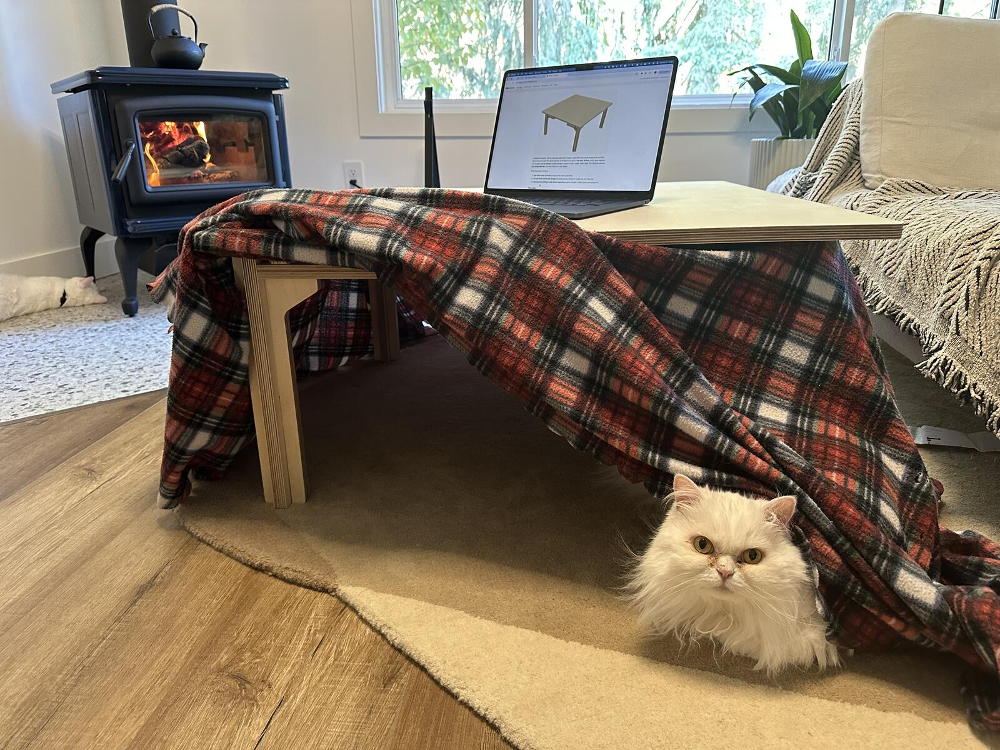](docs/img/home.jpg)

I designed a kotatsu, the low Japanese table with a heater underneath and a quilt draped over it. A CNC
shop cuts every part from birch plywood. It all ships to my door in **one box, for free**, and it goes
together with **no glue and no screws**: wooden wedges, tapped in with a mallet, hold it tight. The 26 parts cost me **CAD $396 with
tax**. The only metal in it is the heater.

Three things got me there:

1. **I set strict rules up front**, so every idea had to pass them.
2. **I let real limits shrink the design**: the shipping box, the futon I could find, and the price.
3. **I checked everything in code before spending a cent**: strength, wobble, knee room and price.

## The rules

I wanted a kotatsu for the winter. I also wanted to make it myself, and I don't own a workshop. So I made
three rules:

- **Plywood only.** Every joint is wood locking into wood. No glue, nails, screws or brackets. The heater
  and its own screws are the one exception.
- **Order it like a book.** Upload a file, pay, wait for the box. No phone calls, no back-and-forth emails.
  I used [uMake](https://umake.ca), a Canadian shop with an instant online quote.
- **It has to be comfortable.** I sit cross-legged, and my knees need about 76 × 32 cm of clear space
  under the edge.

<!-- page: design Design -->

## How the limits shaped it

Most of this table was decided by things other than me: a cardboard box, my knees, a bathroom scale and
uMake's price list. Here are the four fights, and who won each one.

This is the very first full design, from the first afternoon: a 120 × 80 cm top in three boards joined
by dovetails, sitting on solid side panels.

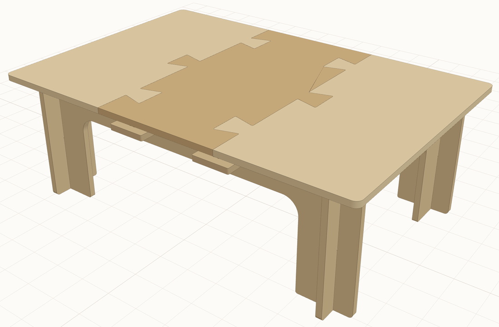

And this is where it ended up:

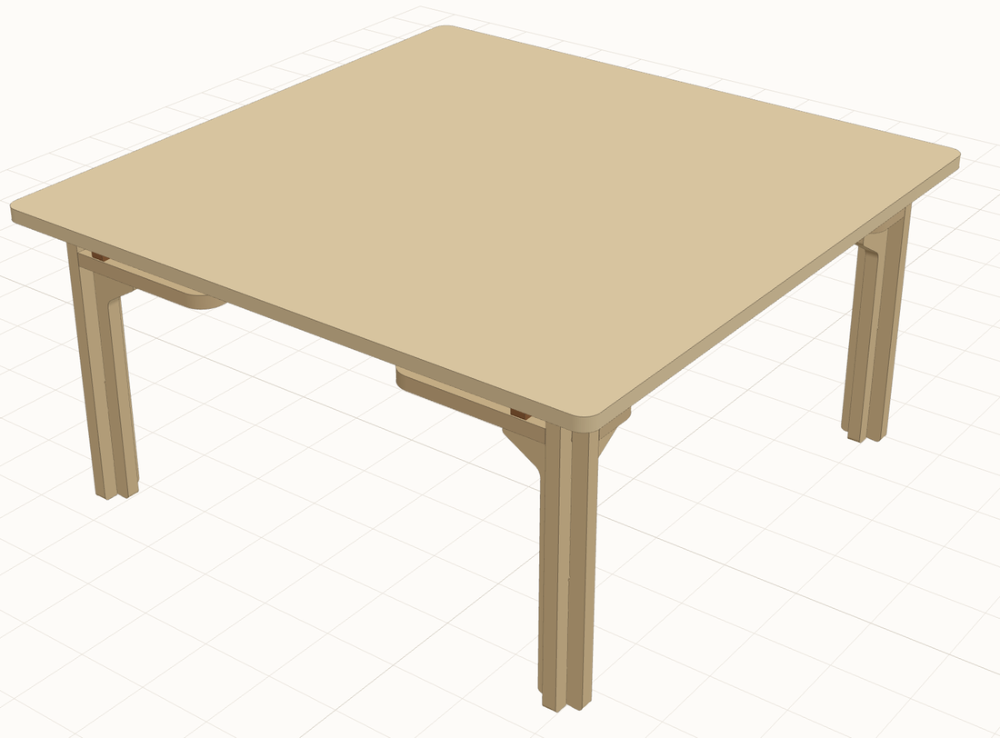

### The top: the box decides

I wanted a big table, 120 × 80 cm. uMake ships free in one box up to 91 cm, so a top that size had to
come in three boards, and joining boards without glue is where the fun was: dovetails, Japanese
arrowheads, salmon tails, fir-cone scales, half maple leaves. I'd drafted a request to commission a
local Secwépemc artist to design one.

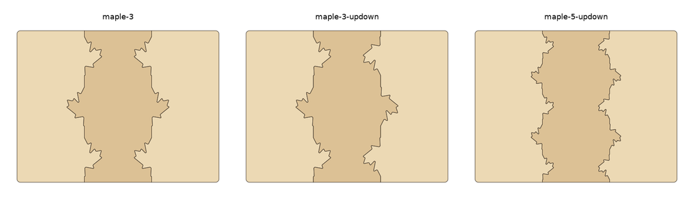

Then I measured my room again, and it works much better with a square table. A round top looked lovely,
but it cost $200 more to ship, and round futons were hard to find at a fair price. The box won: 86 × 86 cm
in one piece, with no joinery at all. I cancelled the commission, and the seams went into a git tag.

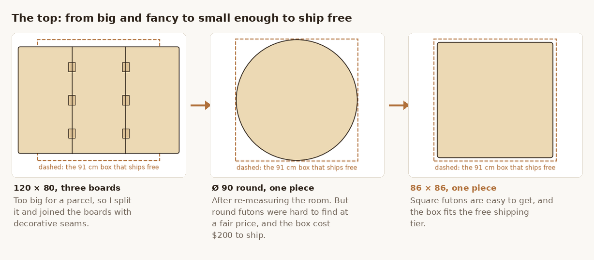

### The frame: my knees decide

Sitting cross-legged, my knees need a space 30" wide and 12.5" high. The first frame had solid side
panels that slot together at the corners. It was strong and simple, and the strip of wood along each
side (the apron) sat exactly where my knees wanted to be. Tapering the legs and flaring the feet bought a
little room. Dropping the aprons altogether bought all of it. That's a *yagura*: four "+"-shaped corner
legs hold up a flat deck, the heater hangs under the deck, and the middle of each side is open, with
34 cm of clearance under the deck.

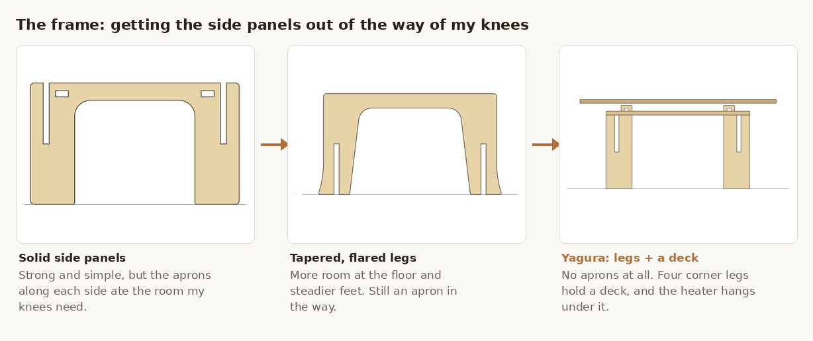

### The legs: the scale decides

The first yagura legs were plain strips, with wood on only one side of each joint. Tapping a wedge in
would have twisted each leg about 9 mm at the foot. A 10 mm shoulder on the other side stopped that.

Then the weight crept up. Free shipping stops at about 20 kg, and the order came to 20.4 kg, which put
shipping at $195. Windows came out of the legs and the deck to get it back under. Then I sketched my own
leg shape, twice: full width under the deck, where the joints are, then a sloped haunch down to a 60 mm
leg. It needs no windows.

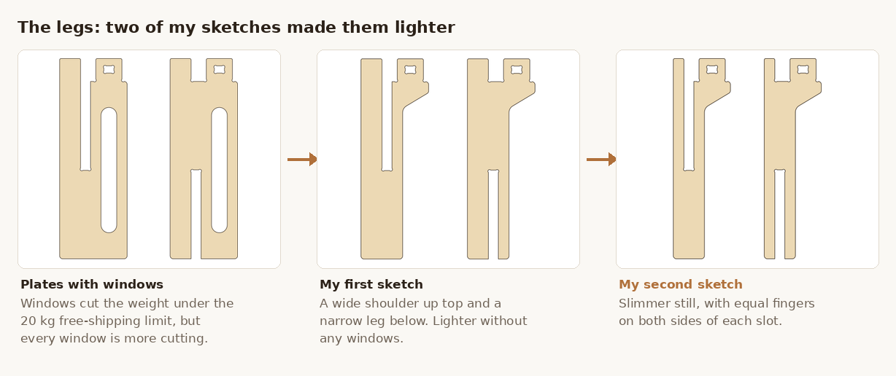

### The deck: the price list decides

Cutting holes in the deck made the table more expensive. A few test uploads showed why: about
three-quarters of uMake's price is the router's path, not the wood, and a window is nothing but cutting.
Opening each window out to the edge took the same wood away with a metre less cutting, and about $20 off.
Rounding the new corners came last.

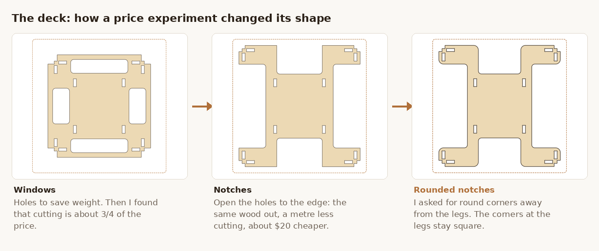

Here's the frame all together, without its top:

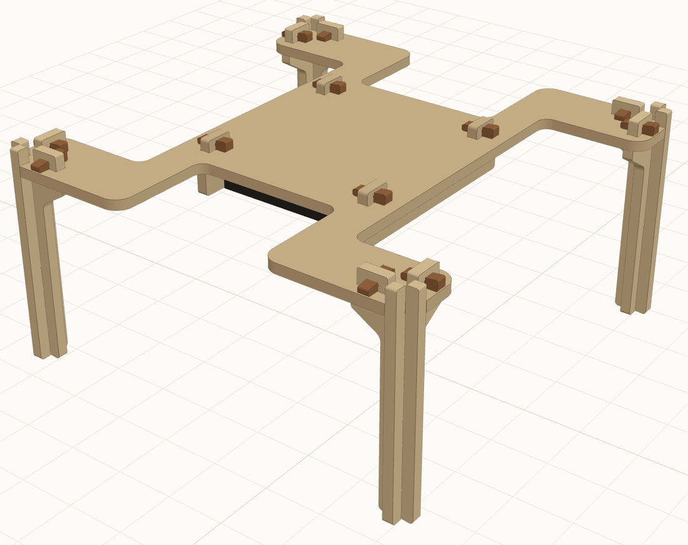

## Checking it in code

I couldn't afford to learn things by cutting wood: every mistake would be a new order and another week
of waiting. So the design lives in code, and nearly 90 tests try to break it every time something changes.

Every dimension lives in one file, `params.toml`, including the things I'm not sure of yet:

```toml
[material]
t_nominal = 18.0
t_min = 17.0          # mill tolerance -1.05 (TODO-verify actual stock in app)
t_max = 18.9          # mill tolerance +0.85

[cnc]
bit_d = 6.35          # 1/4" router bit -> dogbone radius bit_d/2
part_gap = 5.0        # min spacing between parts (uMake)
sheet_margin = 20.0   # margin around sheet (uMake)
```

Python turns it into the outlines the shop cuts (with `shapely` for the 2-D shapes and `numpy` for the
maths), and the tests ask the same questions a woodworker would. The snippets below are from the repo,
lightly trimmed.

### Can a router cut it?

A router bit is round, so it can't cut a sharp inside corner. It leaves a little curve the size of the
bit, and a square edge won't seat in a slot like that. The fix is a *dogbone*: a small circle cut just
past each inside corner. To check that every corner has one, I borrowed a trick from image processing
called *closing*. Grow the shape by the bit's radius, then shrink it back. Anything the bit can't reach
gets filled in, so if the result isn't the same as the drawing, some corner is too sharp:

```python
def closing(g: BaseGeometry, r: float) -> BaseGeometry:
    return g.buffer(r, quad_segs=Q, join_style="round").buffer(-r, quad_segs=Q, join_style="round")


def router_cuttable(g: BaseGeometry, r: float, tol: float = 0.5) -> bool:
    """True if every concave corner already has radius >= r (closing adds no real material)."""
    d = closing(g, r).symmetric_difference(g)
    return all(piece.area < tol for piece in getattr(d, "geoms", [d]))
```

Every frame part goes through it. A square corner leaves about 2.2 mm² behind, which is easy to tell
apart from rounding noise.

### Will it fit together?

This was the scary one. Plywood sold as 18 mm can be anywhere from 17.0 to 18.9 mm thick, and I wouldn't
know which until the box arrived. So every slot is cut for the thickest sheet (19.2 mm), with two small
bumps on each wall, 0.5 mm proud, that narrow it to 18.2 mm. If a sheet turns out thicker, I sand the
bumps down.
The wedges have a 1:8 taper, so they take up whatever is left.

Each joint test runs three times: at the thinnest, the nominal and the thickest sheet. Here's the one
for the leg wedges. Whatever the deck's real thickness, the gap above it has to land somewhere along
the wedge, thicker than its tip and thinner than its head, and the wedge must stay below the futon:

```python
T_RANGE = (BASE.material.t_min, BASE.material.t_nominal, BASE.material.t_max)


@pytest.mark.parametrize("t_deck", T_RANGE)
def test_leg_wedges_clamp_the_deck(Y, t_deck):
    P, L, parts = Y
    z0, z1 = yagura.leg_hole_z(P)
    top = L.z_deck_bot + t_deck
    wl, wh = yagura.wedge_dims(P, "leg")
    need = z1 - top
    assert wh - wl * P.fit.wedge_taper < need < wh
    assert L.z_deck_top + wh <= L.H - 3, "wedges stay under the futon plane"
```

### Will it wobble?

There's no big engineering package here, just small models I could read. Each leg-to-deck joint is a
handful of springs: the leg's shoulder pressing up under the deck, the wedge pulling the tenon up, and
the tenon's faces bearing on the sides of its hole. The catch is that wood in contact can push but
not pull: lean on the table and one side of a joint can lift off. The model handles that with
"compression-only" springs, smoothed just enough (a *softplus*) that Newton's method can step across
the moment a gap opens:

```python
EPS = 0.002   # mm: contact smoothing (softplus) so Newton can cross contact changes


def _pos(c):
    return EPS * np.logaddexp(0.0, c / EPS)
```

A firm 100 N sideways push (about 10 kg) sways the table about 0.9 mm. The model also caught a sneaky
problem before I ordered: when the tenon ran right to the leg's inner edge, tapping the wedge in
twisted the leg about 9 mm at the foot. A 10 mm shoulder on the other side fixed it.

### Will the top break?

The top is a loose board resting on the four corner posts. The model treats it as a grid of little
beams that bend and twist like a plate. The posts can hold the top up but can't hold it down, so the
solver works it out in rounds: solve, find any post that would have to pull, let it go, and solve
again.

```python
for _ in range(30):                                       # compression-only supports
    fixed = sorted(idx(i, j) for i, j in active)
    free = np.setdiff1d(np.arange(N), fixed)
    u = np.zeros(N)
    u[free] = np.linalg.solve(K[np.ix_(free, free)], F[free])
    R = F - K @ u                                         # what the pads must push on the top (+ = upward, compression)
    neg = [(i, j) for i, j in active if R[idx(i, j)] < -1e-6]   # pad would have to pull the top down
    if not neg:
        break
    active -= set(neg)
```

Before trusting it, a test checks it against the textbook answer for a square plate with a weight in
the middle (Timoshenko's), and it lands within 3 %. Then come the loads I actually care about:

```python
"nap: cat curled in the middle, laptop pushed back": arms(nap) + curled_cat(0, 120) + laptop,
"slump: flopping down (x1.5) + cat jumping up mid-table (x4)":
    arms(Ld.slump * nap) + paws(Ld.cat_impact * cat, 0, 0) + laptop,
"cat lands on the corner (x4), nobody else": paws(Ld.cat_impact * cat, h - 60, h - 60),
```

Napping hunched over the table with a 7 kg cat and a laptop uses about 7 % of the wood's strength and
sags it 1 mm. Even an 80 kg adult sitting hard on an edge uses about a quarter.

### What will it cost?

uMake quotes instantly, so I uploaded a few test shapes and wrote down the prices. Each part costs a
rate per square metre of wood, plus a rate per metre the bit travels, plus a little per hole. Then the
order total follows a volume curve:

```python
A_RATE, L_RATE, H_RATE = 101.03, 15.25, 0.18     # $/m2, $/m of cut, $/hole (raw, before the volume curve)
K, B = 11.25, 0.551                              # total = K * raw ** B  (fit: 6 probe states + the real order)


def raw(g) -> float:
    a, l, h = features(g)
    return A_RATE * a + L_RATE * l + H_RATE * h
```

It predicts uMake's quotes to within 15 cents, and for the real order it says $353.38 against the
$353.33 I paid. It also showed that about three-quarters of the price is cutting, not wood, which is
why the deck's windows became notches open to the edge: same wood out, a metre less cutting.

### Will it fit on the sheet?

All 26 parts go on one 48 × 96" sheet. The packer draws each part on a grid of 4 mm squares, then
uses a Fourier transform to test every position on the sheet at once, the way image software finds a
pattern in a photo:

```python
F = np.fft.rfft2(occ.astype(np.float32), sh)
M = np.fft.rfft2(m[::-1, ::-1].astype(np.float32), sh)
corr = np.fft.irfft2(F * M, sh)[mh - 1:H, mw - 1:W]
return corr < 0.5
```

Big parts go first and the wedges fall into the gaps. A test then measures the real distances: no two
parts are closer than 7.35 mm (the shop asks for 5, and the bit needs room to pass between them), and
nothing crosses the 20 mm margin.

The same packer folds the parts flat into the top's footprint for summer.

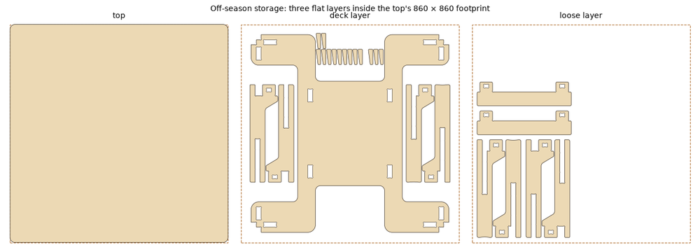

<!-- page: build Build -->

## Building it

The box arrived at the end of October: one flat parcel, with every part in a single shrink-wrapped stack.
The feline QA department was eager to begin inspections.

[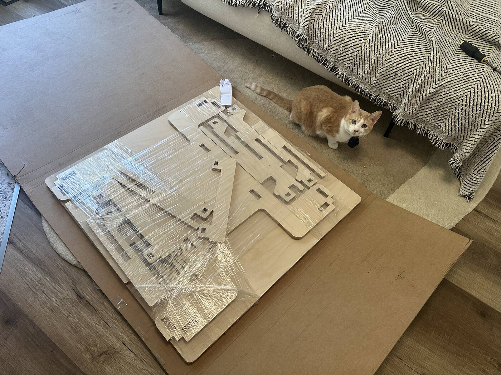](docs/img/build-1-box.jpg)

Unwrapped, it's the H-shaped deck, the two heater cheeks, eight leg plates crossed into four "+" legs, and
a small pile of wedges. The top waits at the side.

[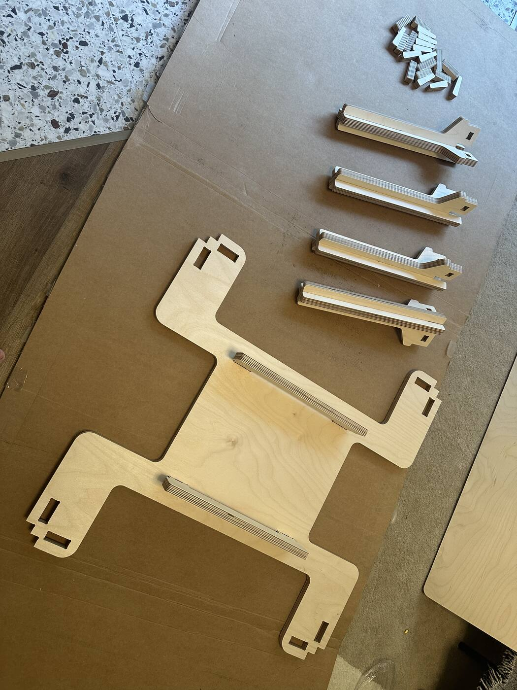](docs/img/build-2-parts.jpg)

The legs stand up, the deck drops over their eight tenons, and the cheeks hang through it. A wedge goes
through every tenon and cheek tab. For now I pushed them in by hand, not with a mallet, so the table still
comes apart easily.

[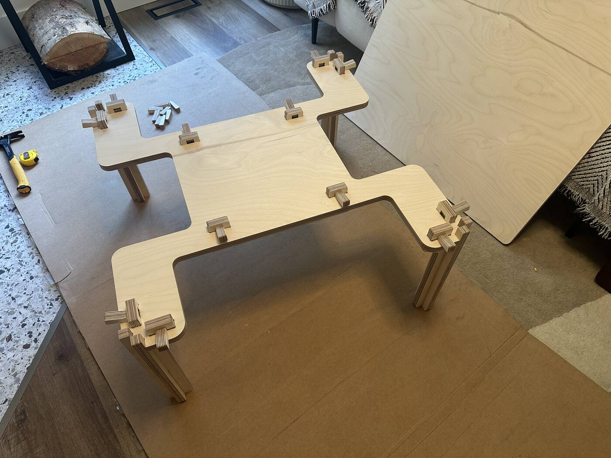](docs/img/build-3-frame.jpg)

Flipped over, the heater screws in between the two cheeks, after drilling a pilot hole for each screw.
Right way up again, it hangs under the deck, grille down.

[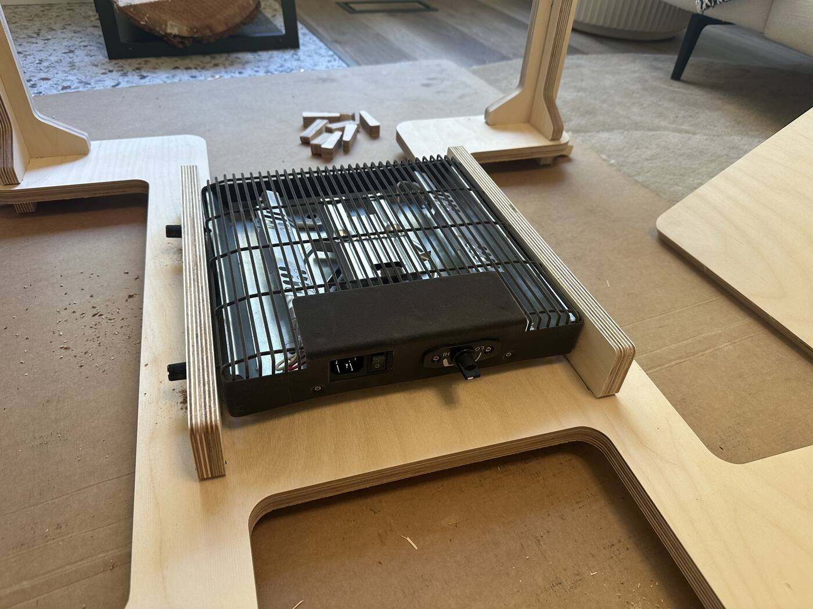](docs/img/build-4-heater.jpg)
[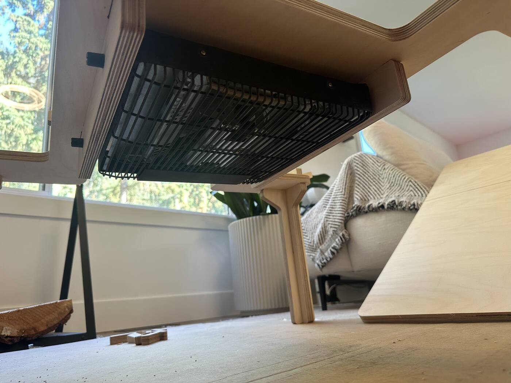](docs/img/build-5-under.jpg)

Putting the frame together took under a minute. The heater's holes took about five more, most of them
spent looking for the right drill bit.

## In use

For now, a fleece blanket I had at hand went over the frame, with the top sitting on it. A proper kotatsu
futon should be arriving in the next week. Until then, it's tea, crosswords, and the cats keeping an eye
on things. The heater is incredibly warm and comfortable. I cranked it for a couple of hours to get rid of
the factory smell, then lowered it to medium.

[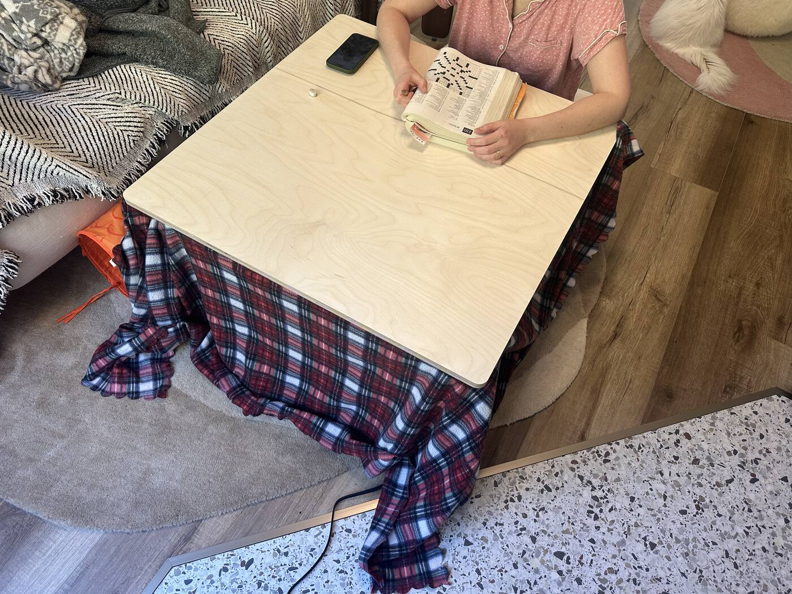](docs/img/use-crossword.jpg)
[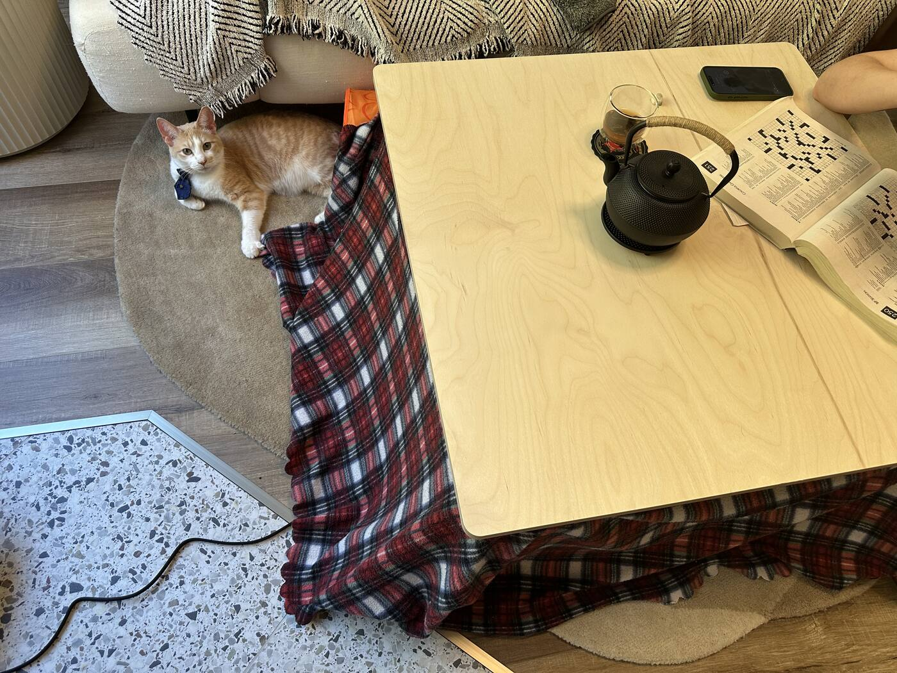](docs/img/use-tea.jpg)
[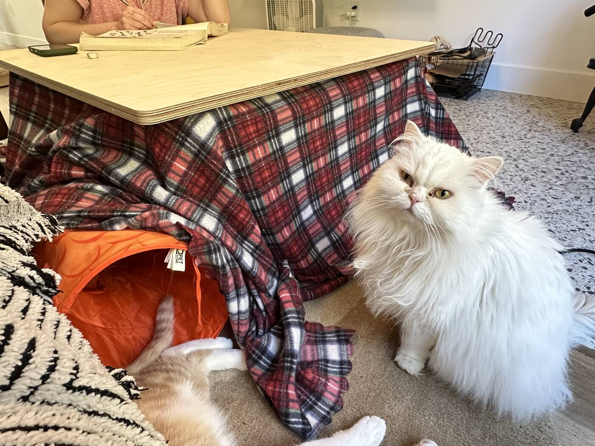](docs/img/use-blanket.jpg)
[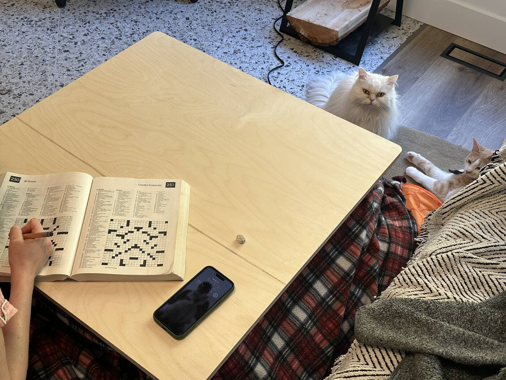](docs/img/use-cats.jpg)

<!-- page: v2 Version 2 -->

## Version 2

v1 works, and it gets used every evening. Living with it showed me what I'd change, so version 2 is
taking shape on its own branch. It isn't ordered yet. This chapter grows as it does. I wanted four things:

- **The heater sat low.** It hung under the deck, right where shins go.
- **A lighter box.**
- **Fewer wedges.** Let gravity do some of the work.
- **Rounder corners.**

### The heater moves into the deck

The deck now has a hole in the middle, and the two heater cheeks became a cradle. I screw the heater
between them on the floor, then lower the whole thing into the hole. An ear at each end of the cheeks
rests on the deck, so gravity holds it up, and in summer it lifts straight out. The heater's top sits
flush with the deck: 309 mm off the floor instead of 286, and four fewer wedges.

### Thinner plywood

Every part drops from 18 to 15 mm. Each joint is checked again across the range the shop's 15 mm sheet can
really measure. The top bends a little more: when an adult sits hard on its edge, it sags about 9 mm
instead of 4. A test quote showed that 15 mm costs about the same as 18 mm, so the saving is weight,
not money.

### One wedge per leg

Could gravity hold the legs as well? Not on its own: the wobble model says the frame would sway about
9 mm under a light push. But one wedge per leg is enough, if the wedges alternate. Each leg's other
plate is trapped between the floor and the wedged-down deck, and hangs on its partner when I lift the
frame. That plate doesn't even need a tenon any more, so the deck has 4 mortises instead of 8. The
model counts the gravity-held plates as doing nothing, and still gets only 2 mm of sway under a hard
shove (v1: under 1 mm). The finite-element check further down found the legs softer than that, and
weaker.

### An X deck and a squircle top

The deck becomes an X: a pad at each corner, a ring round the heater, and four arms at 45°, with a big
fillet in every inside corner. v1 had rejected an X deck, because its openings let the futon sag right
where the knees go. The ring round the heater fixes that. Each corner pad keeps only the wood that
does something: round the mortise, under the wedge and over the plates' tops.

The top is a squircle, a curve that eases into its straight edges instead of starting suddenly like a
radius. I liked it so much that every other corner got the same treatment: the legs' haunch is now one
smooth S-curve instead of a slope with two small fillets, and the feet and shoulders are squircles too,
as round as their jobs allow. (The feet stand on just 8 mm at each end, so they can't get much rounder.)

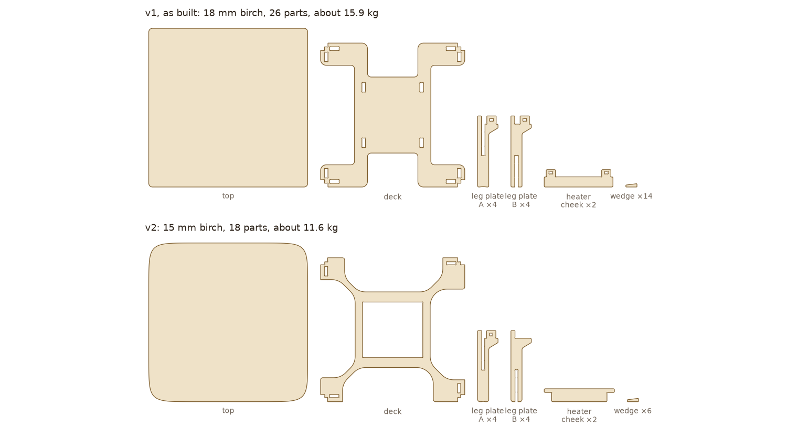

### Two zaisu

There was room on the sheet and in the budget for two **zaisu**: legless floor chairs with a back. Each one
is five parts and no wedges. The seat board's tabs go through the side frames, so sitting down holds
the chair together and stops it tipping back. The stretcher and the back hook in, then drop 6 mm to lock.
They're squircles all over: a big sweep where the post meets the runner, round post tops, and cut-outs
in the seat and the back shaped like the top.

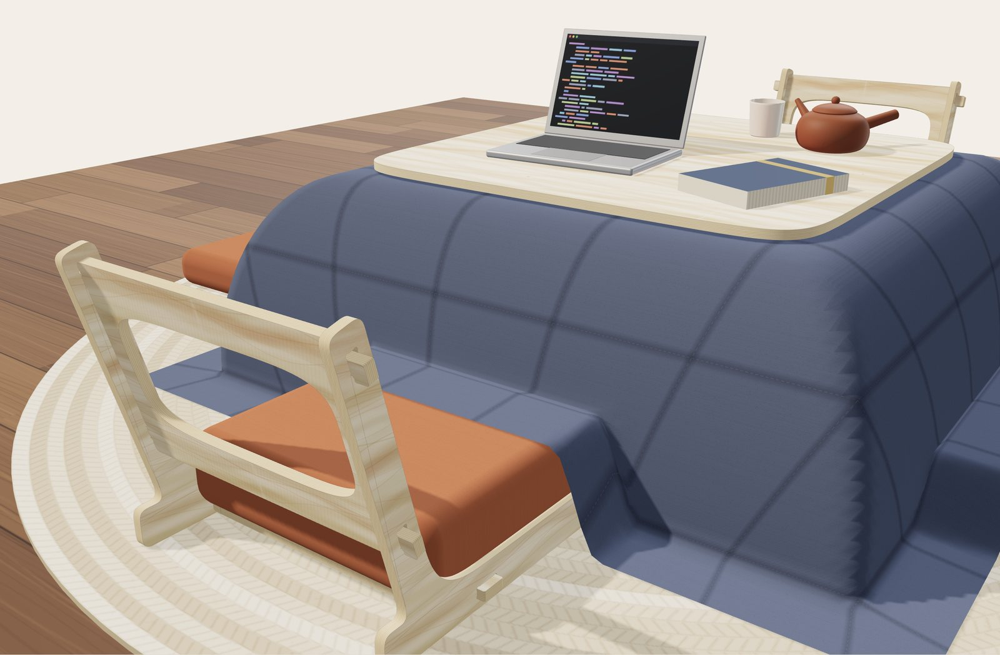

The first draft had back posts working at 15 % of their strength, so I asked for less wood. That turned
up something more interesting: the posts were the wrong place to look. Leaning back pushes the back
panel and the seat board face-on, across their 15 mm, and nothing was checking those. They work at
about 40–46 %, so they stayed as they were. The posts went from 60 to 50 mm (the least that leaves the
shop's 15 mm of wood beside their slots) and now stop at the top of the back instead of standing 13 cm
above it. Each chair came down to 3.4 kg.

The seat board sits as low as the shop's rules allow, 31 mm off the floor. Then the cushion: how thick
could it be? My knee height (32 cm cross-legged) was measured on the bare floor, so a chair raises it by
the whole seat. With the knees under the table's edge, that left room for only a thin, firm cushion (4–5 cm), and
it showed a hole in the comfort model: it had never checked the top itself, so any knee height
"fitted". On a zaisu I'll sit with my legs out under the table instead: thighs under the deck, feet
under the heater. My cushions are 10 cm thick, and even if they didn't squash at all there'd be
room to spare. On the floor-pillow sides nothing changes: v2 has the same knee room as v1, or a little more.

### A second opinion

v1's checks are small models I can read. For v2 I wanted a heavier check, so a second AI agent wrote
a finite-element model of the three parts that carry load: the top, the deck and the leg plates. It
worked on its own branch while the chairs took shape, and reported back:

- **The top:** the simple model was right, within 10 %.
- **The deck:** it works harder than I thought: up to about 68 % of its strength under a hard press on
  the ring round the heater, not 40 %. Arms at 45° to the grain are softer and weaker than the simple model assumed.
  That's fine as long as the wedges stay tight. With slack wedges it's overstressed, so I'll re-tap them
  every season.
- **The legs:** a real problem. Above its cross-lap slot, the wedged plate is two separate 22 mm
  fingers, and the wedge hangs the whole joint's bending on one of them. My spring model had quietly
  treated the slot as glued shut. A hard 200 N shove used 160 % of the leg's strength and swayed it
  12 mm.

My first fix, a shallow slot in one plate and a deep one in the other, made it worse: the peak just moved
to the new slot's bottom. The plain fix worked: the narrow part of the legs went from 60 to 70 mm. The
same shove now uses 87 % at worst and sways the frame 7.2 mm. It costs 0.25 kg and 2 cm of room between
the legs at shin height, and none at the knees.

### Seeing the stresses

Numbers in a table are easy to skim past, so the 3-D view can now paint them on the parts. Pick a load
case and the part turns blue where it's idle, yellow at half its strength and red at all of it. It bends,
exaggerated, as the load comes on and off.

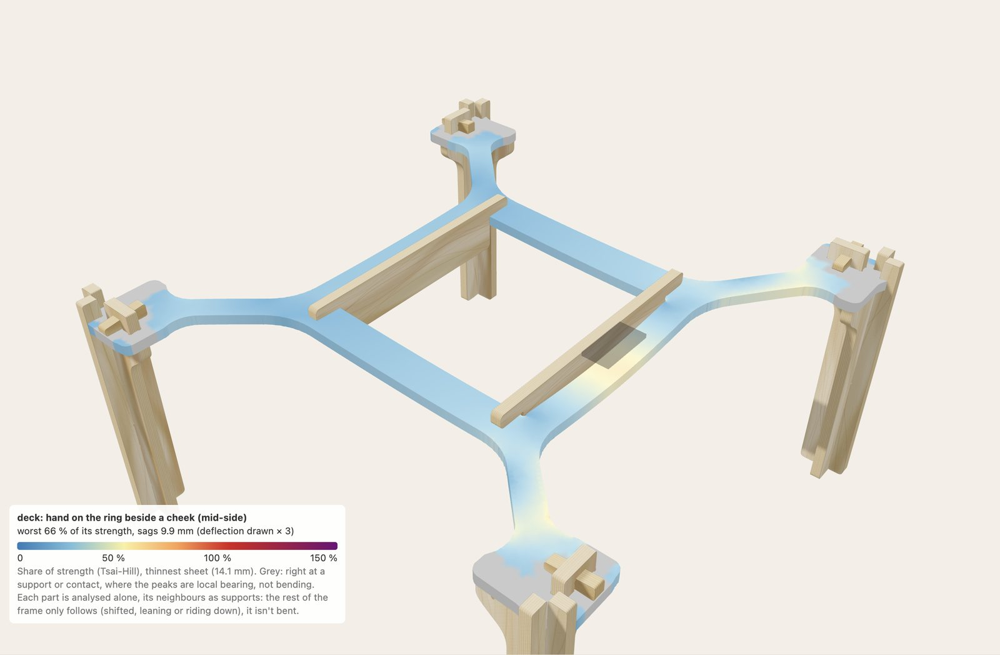

The first version taught me something about the model, too. In the legs' case, plate A swung right
through plate B. Nothing was wrong with the joint. Each part is analysed on its own, its neighbours
standing in as springs and supports, and the view had drawn one plate bending while the rest of the
frame stood still. At true scale, the slot round B narrows by 0.2 mm at most, and B has 0.9 mm to
spare. Now the frame moves with the analysed part: the feet stay put, the deck sways, and the other
plates lean along.

| | v1 | v2 so far |
|---|---|---|
| Parts | 26 | 18, plus 10 for the chairs |
| Weight | 15.9 kg | 11.6 kg, plus 6.7 for the chairs |
| Wedges | 14 | 6 (4 + 2 spares) |
| Clear height under the heater | 286 mm | 309 mm |
| A hard 200 N shove, finite elements | not checked | 87 % of the legs' strength, 7.2 mm of sway |
| uMake | $353.33 (the order) | about $472 for the table and chairs (my estimate; the table alone quoted $328.70 before the later changes) |

Before I order it, I want to measure how I really sit (no tape to hand yet), check that the heater's top
stays cool with the futon right over it, and find out how thick uMake's 15 mm sheet really is. Then a
fresh quote.

<!-- page: overview -->

## Where it stands

I placed the order in October 2026. One surprise: uMake's checkout ends with "a representative will reach
out to confirm". So I still got one email. Next, the table comes apart again and goes to the garage
for sanding, staining and wax.

Version 2 is in the works: lighter, with the heater up in the deck, two floor chairs, and a finite-element
check that found (and fixed) weak legs. See the Version 2 chapter.

I worked through all of this over about two days with an AI coding agent. I made the choices and drew
the sketches. It wrote the geometry code and tests, ran the numbers and filled in the quote forms.

<!-- page: make Make your own -->

## Make your own

<!-- github-only -->

The website has the drawings, a 3-D view, the cut sheets and all the numbers:
**https://lixo.org/kotatsu/**.

<!-- /github-only -->

The cut files (DXF, in millimetres) are at **https://lixo.org/kotatsu/dxf/**, and the code that makes
them is at **https://github.com/cv/kotatsu**.

| Part | Detail |
|---|---|
| Top | 860 × 860 × 18 mm, one piece, sits loose on the frame with the futon in between |
| Frame | four "+" legs (8 plates, 2 shapes) under an H-shaped deck; 2 cheeks hold the heater |
| Joints | cross-laps and wedged through-tenons; 14 wedges (2 spare) |
| Height | about 40–41 cm with a futon |
| Order | 26 parts, 16.6 kg, one 91 × 91 × 16 cm box; CAD $353 + tax on uMake (Oct 2026) |
| Heater | 120 V 400 W replacement kotatsu heater, 29 × 29 × 5 cm, screws in at the sides |

```sh
uv sync
make test      # the checks
make dxf       # out/dxf/parts/*.dxf, sheet layouts and out/BOM.md
make site      # the website, in out/site
make dev       # serve it on :8765 and rebuild on every change
```

`PLAN.md` has the decisions and open questions. `docs/` has the research on the shop, heater, futon
and quote. `AGENTS.md` has the project's rules.

### Make it yours

Every size is a number in `params.toml`. Change one, run `make all` and `make test`, and the parts, cut
sheets, price, weight and 3-D view all follow. The tests tell you when a change breaks something. Here's
what a few changes do, run through the same code:

| Change | What happens |
|---|---|
| A smaller top, 76 × 76 cm | $339 instead of $353, so smaller barely saves anything: most of the price is a fixed share plus cutting. 13.9 kg, and it fits a 60 × 60" sheet. |
| A bigger top, 100 × 100 cm | $374 to cut, but the box goes past 91 cm, so uMake adds about $195 for shipping. It also weighs 20.5 kg, over the free-shipping weight. The parcel test fails. |
| A lower frame, 355 mm instead of 385 | It sways less (0.3 mm at 100 N, against 0.9), but the deck's underside drops to 311 mm, under the 317.5 mm my knees need sitting cross-legged. The knee test fails. Set your own in `[comfort]`. |
| A bigger heater, 33 × 33 cm | The cheeks move apart by themselves. Every test passes, and the price doesn't change. |

Measure your own heater and put its size in `[heater]`. Don't guess it from a listing.

Ideas I built and then dropped are kept as git tags, so you can check one out and build it:

- **`seams-archive`**: the 120 × 80 cm top in three boards, joined by decorative seams (dovetails,
  arrowheads, maple leaves), and a 90 cm round top. Round looked lovely, but it cost $199 to ship, and
  round futons wouldn't ship here.
- **`frame-variants-archive`**: the solid-sided frame with tapered legs and flared feet, and a yagura
  with splayed legs.
- **`options-archive`**: windows in the deck and legs, an X-shaped deck, lighter-looking cuts, and
  modules that link several tables into a row.

### Ordering somewhere else

I only ordered from uMake, in Canada. If you're somewhere else, look for a shop that **CNC-routes 18 mm
(3/4") birch plywood** from a DXF and can cut a part 86 cm across. Ideally it should also give you a
price online, without a phone call. These are the ones I found in October 2026. I haven't ordered from
any of them, so check before you rely on one (the details and sources are in `docs/research.md`):

| Where | Shop | What I found |
|---|---|---|
| Canada | [uMake](https://www.umake.ca/) | What I used. Instant quote, CNC-routed "19mm" Baltic birch, free shipping in one box up to 91 cm |
| Canada | [EZCNC](https://ezcnc.ca/), [Laseo](https://www.laseo.ca/services/cncrouting/) | Both take a DXF online. Laseo shows a price instantly and lists Baltic birch. I haven't checked their thicknesses |
| US (I think) | [ConceptCut](https://conceptcut.net/) | Instant DXF quotes for 18 mm Baltic birch on 48 × 96" sheets, priced by sheets used plus length of cut. Its site works in inches but doesn't say where it is or ships to |
| US | [SendCutSend](https://sendcutsend.com/materials/baltic-birch-plywood/) | Instant quotes, but its birch only goes up to 12 mm, and 44 × 44" parts. This design would need a 12 mm rework |
| UK | [Chop Shop CNC](https://chopshopcnc.com/cnccutting) | Instant quotes from a DXF, delivery anywhere in the UK |
| France | [Vectorealism](https://www.vectorealism.com/fr/fraisage-cnc/) | Online CNC routing in 15 and 18 mm birch, on 60 × 60, 120 × 120 or 180 × 120 cm sheets. You upload, and the quote comes back by email |
| Netherlands | [Moderne Ambacht](https://www.moderneambacht.com/prijzen/) | A price calculator instead of an upload: €90 an hour of routing, and 18 mm birch at about €106 a sheet |
| Australia | [Laser Cutting Experts](https://lasercuttingexperts.com.au/cnc-router-cut-plywood) (Sydney), [GV CNC](https://www.gvcnc.com.au/quote.html) (Victoria) | Both price a DXF for plywood routing instantly |
| India | [HyperFabs](https://hyperfabs.com/) (Mumbai) | Instant quotes. Its listing says CNC-routed plywood up to 18 mm |
| Brazil | [ZiOLAB](https://www.ziolab.com.br/corte-compensado/) | Router-cut plywood (compensado) in 4–25 mm, 18 mm included, on 1600 × 2200 or 2500 mm sheets. Quote on request |
| Argentina | [Trebol CNC](https://trebolcnc.com.ar/servicios) | A 2 × 3 m router; 18 mm guatambú and phenolic plywood (multilaminado). Free quote on request |
| Chile | [CNC Studio](https://cncstudio.cl/) (Santiago), [Andes Maker](https://andesmaker.cl/comocotizar/) | Both route 18 mm plywood (terciado) from a DXF. CNC Studio answers within a working day; Andes Maker can cut plywood you bring |
| Colombia | [Makers Medellín](https://makersmedellin.com/cotizacion/) | An instant online quote: upload a DXF or SVG, pick the material and thickness, get a price straight away |
| Peru | [Laser Cut Peru](https://lasercutperu.com/servicio/corte-router-cnc-lima-peru/) (Lima) | Routes plywood up to 60 mm on a 1.3 × 2.5 m bed. Free quote by email |

Whichever shop you pick, tell the code about it in `params.toml`: the bit size (`[cnc] bit_d`, for the
dogbones), its sheet sizes, the gap it wants between parts and round the sheet's edge, the real
thickness range of its plywood (`[material]`), and its shipping limits (`[shipping]`). The 91 cm box is
uMake's rule, not a law of nature. A makerspace with a CNC router works too: the DXFs are ordinary cut
files.


**Caveats.** The plywood strength figures are rough textbook values, so read the load numbers as "lots of
margin", not as a certificate. uMake sells this sheet as "19mm", and the joints are designed for
17.0–18.9 mm. Follow your heater's instructions and clearances, and make sure it's rated for your mains
supply.

<!-- /story -->

## License

MIT, see `LICENSE`.
